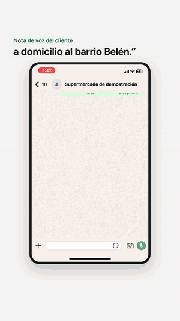
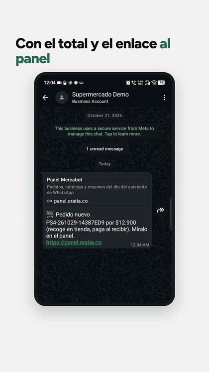
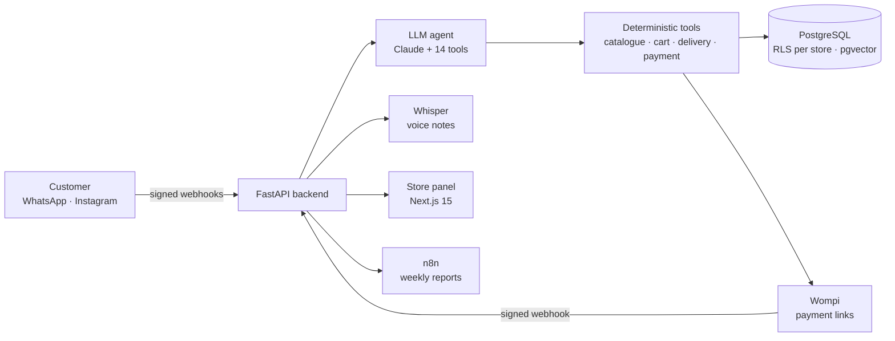
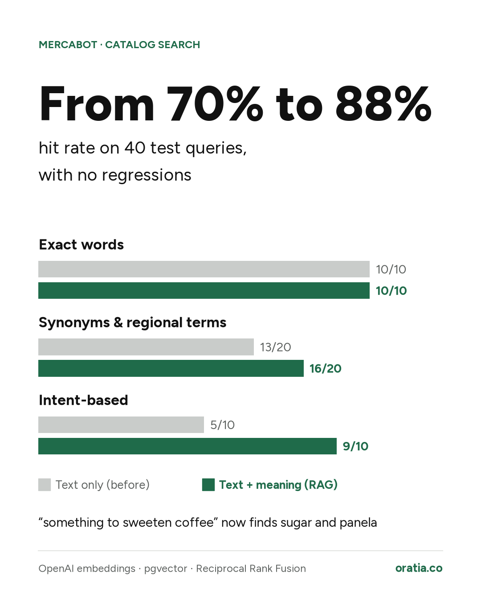

# Mercabot · WhatsApp ordering assistant for supermarkets 🛒

**Mercabot** lets a supermarket take orders on **WhatsApp and Instagram** with an LLM agent that understands text and voice notes, builds the cart with the store's real prices, takes the delivery address, charges online and sends the order to the store's panel.

It is the first product of [**Oratia**](https://oratia.co), the AI company I founded in Ibagué, Colombia, and it runs in production. **The source code is private**; this repository documents what it does, how it is built and how it is tested.

  
  &nbsp;&nbsp;
  

Left: an order placed with a voice note, from the cart to the payment link. Right: the same kind of order in the store panel. The demo is in Spanish, the language of our customers.

## What it does

- 🎙️ **Text and voice notes:** voice is transcribed with Whisper (local faster-whisper or the OpenAI API).
- 🧾 **Cart with real prices:** the agent searches the catalogue, handles units by weight and suggests recipes ("sancocho for six").
- 📍 **Delivery or pickup:** validates the delivery zone and opening hours before payment.
- 💳 **Online payment:** Wompi payment links (card, PSE, Nequi) or cash on delivery.
- 🔔 **Store notifications:** the manager gets a WhatsApp alert for each new order or when a customer asks for a human.
- 🖥️ **Store panel:** orders, conversations (take over from the bot and hand back), catalogue by CSV, recipes, product photos, settings and metrics. Spanish and English.

## Architecture

## Design decisions

- **The model never sets prices.** Tool schemas have no price field and undeclared arguments are dropped; every amount comes from the database and the payment link is signed with it.
- **A "yes" only confirms a summary the customer already saw.** If the cart changes after the summary, it is shown again before charging.
- **Multi-tenant by construction.** Every query runs in a transaction scoped to one store (`SET LOCAL` + forced Row-Level Security, with an app role that cannot bypass it). A request for another store's order returns 404.
- **Idempotent, reconciled payments.** Wompi webhooks are verified by signature, processed once and checked against the order amount.
- **Resilient agent.** Static prompt cached (prompt caching) and automatic fallback to a backup model when the API fails.

## Quality and results

| | |
|---|---|
| ✅ **314 automated tests** (pytest) | tenant isolation, tools, payments, agent, API, panel, CSV import |
| 🧪 **15 agent evaluations** on real flows | deploys only with **90 % or more** |
| 🔍 **Hybrid search (RAG)** | catalogue hit rate **70 % → 88 %** on 40 test queries, no regressions |
| 📊 **Observability per turn** | p50 / p90 / p95 latency, tokens, cache use, cost per conversation, escalations |
| 🔁 **CI/CD** | GitHub Actions: tests, build and Docker images on every push |

  

## Stack

**AI:** Claude API (tool use, prompt caching) · OpenAI embeddings · pgvector · Reciprocal Rank Fusion · Whisper 
**Backend:** Python · FastAPI · Pydantic · PostgreSQL (RLS, Spanish full-text search) · pytest 
**Integrations:** WhatsApp Cloud API · Instagram Messaging API · Wompi · n8n · MCP 
**Frontend:** Next.js 15 · TypeScript 
**Infrastructure:** AWS Lightsail (Ubuntu, systemd) · Cloudflare Tunnel · Docker · GitHub Actions

## Learn more

🌐 [oratia.co/mercabot](https://oratia.co/mercabot) · 💼 [Walter Cárdenas on LinkedIn](https://www.linkedin.com/in/walter-andres-cardenas-b402aa344)

© Oratia. Screens use a demo store with sample prices; customer phone numbers are blurred.
